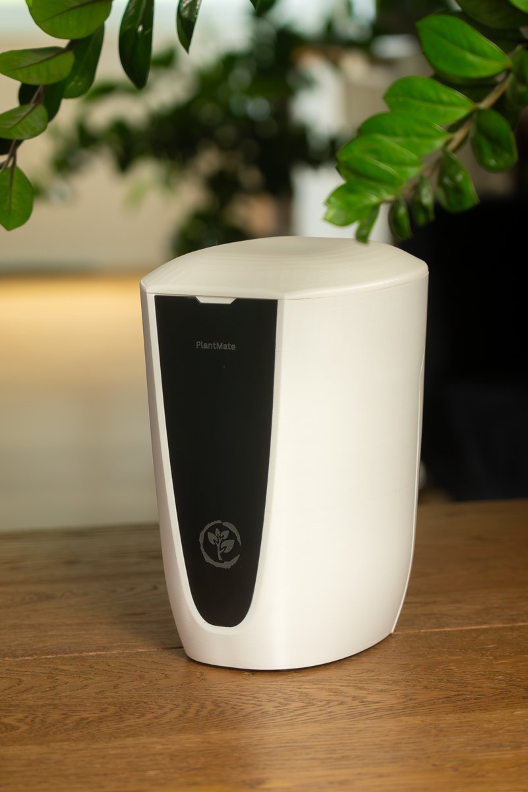
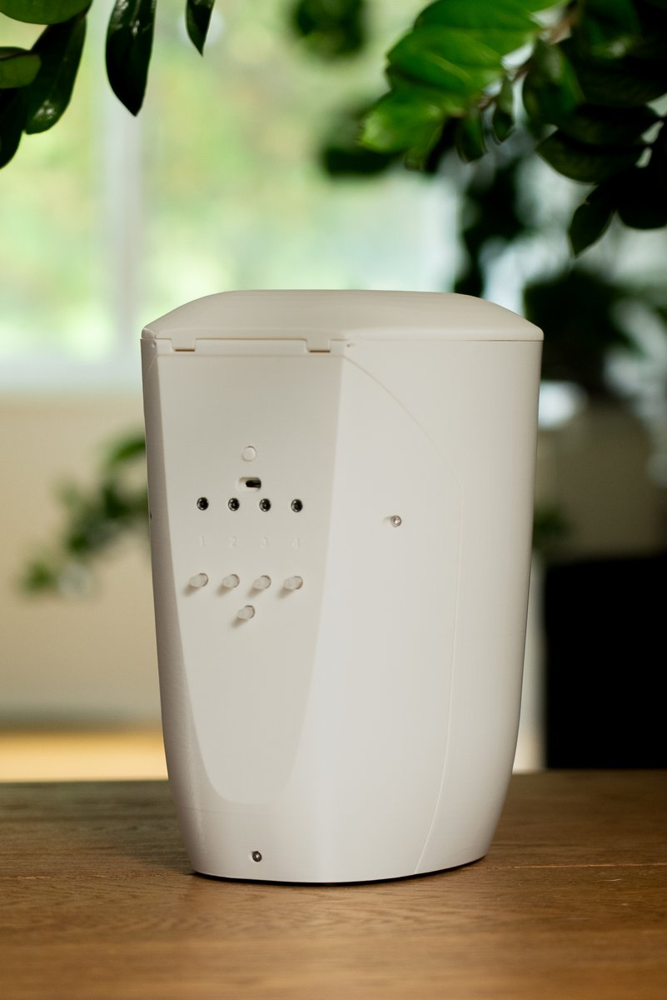
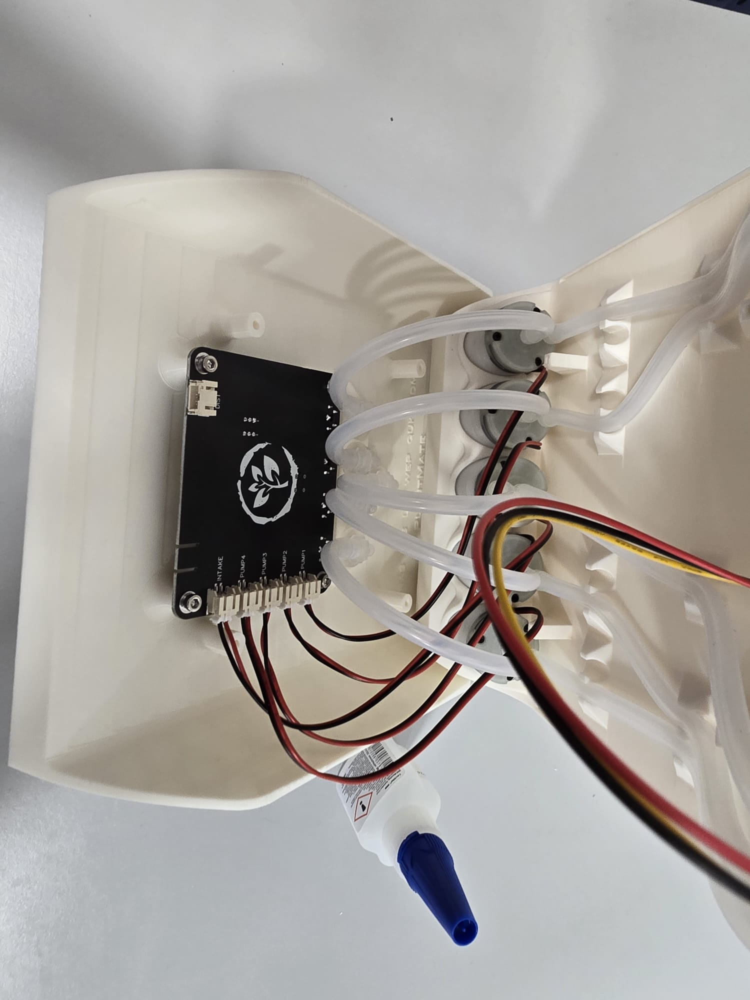
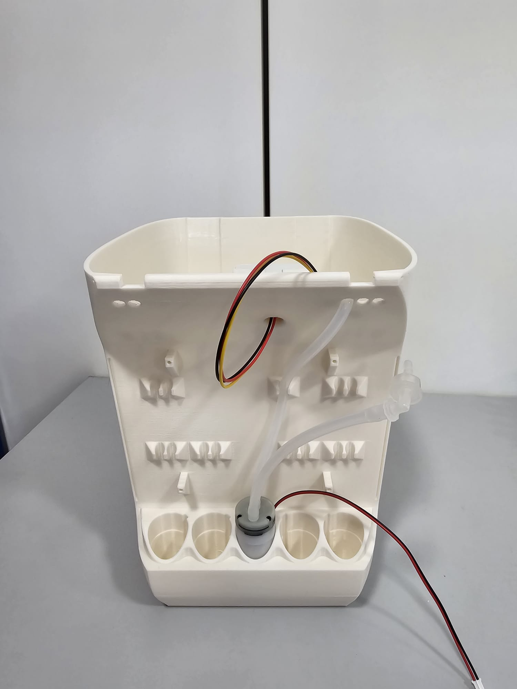
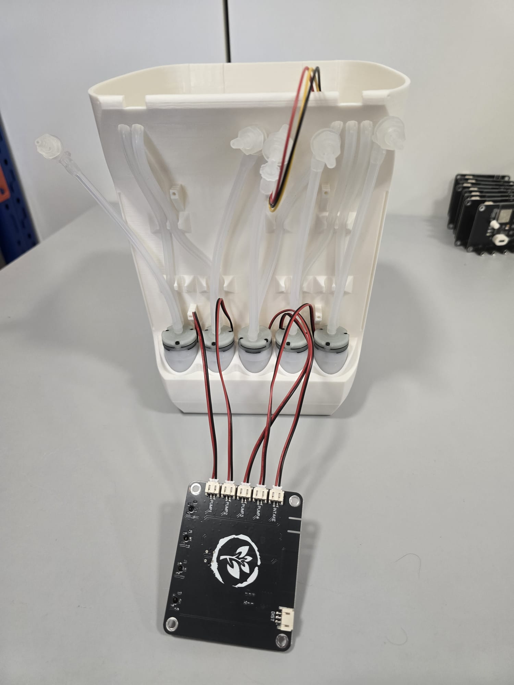
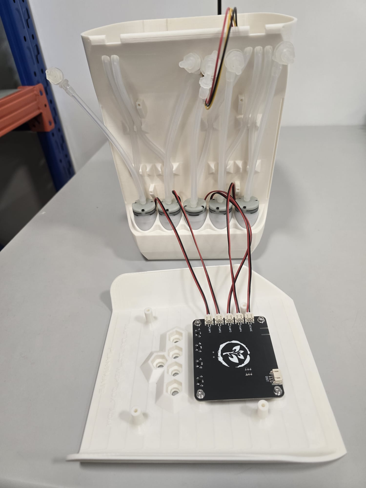
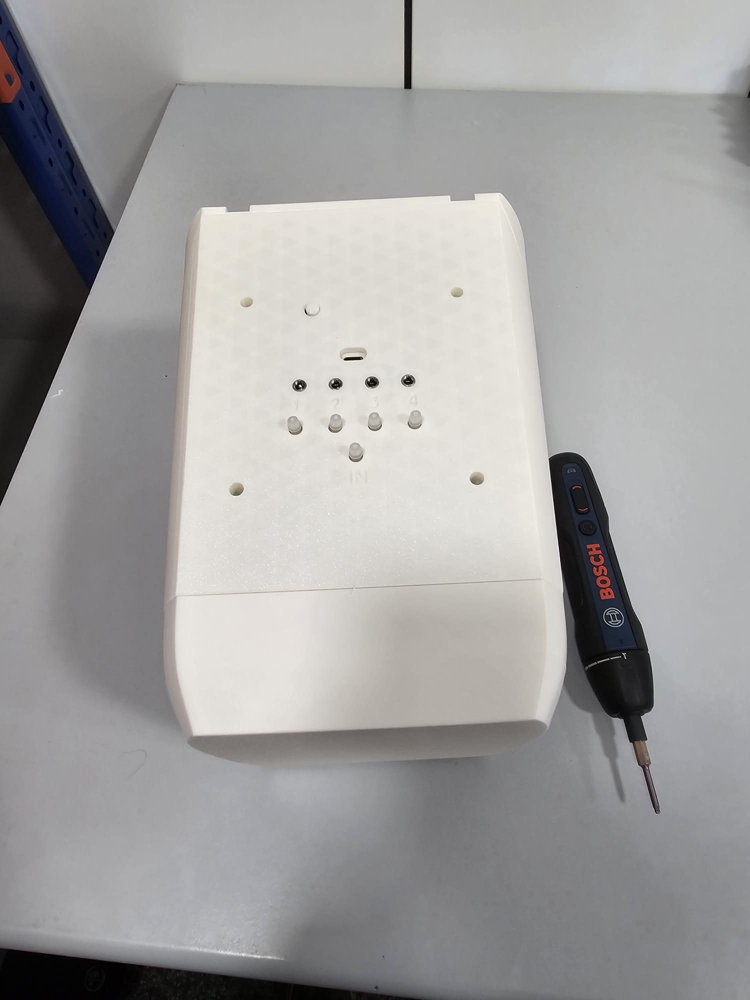
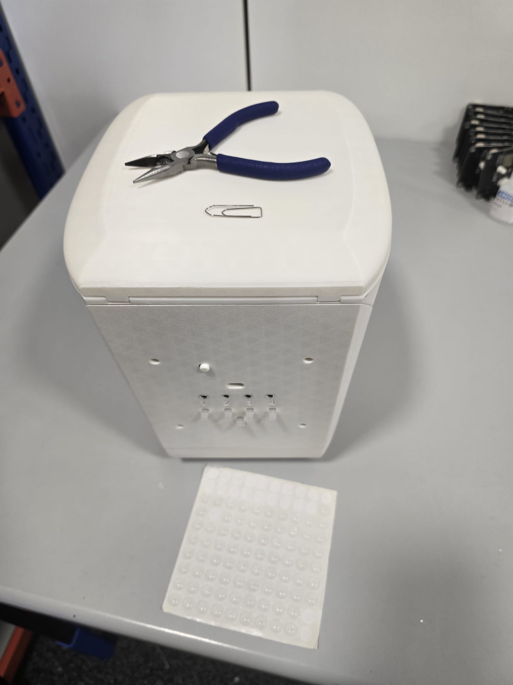

# PlantMate

  
  

This is the open source release of PlantMate, an automatic plant watering system. The Kickstarter itself was funded (500 backers, over 500% of the goal), but we ran out of money during fulfilment when shipping and import costs came in far above what we had planned for. The product was fully built and it does work.

It does have a few fundamental flaws though. I'd like to start with those, since if you do decide to build a unit we'd like you to know what you are getting.

**At a glance:** 4 L tank, 4 independently controlled outlets, 1 intake pump for refilling from an external source, ESP32 with WiFi, USB-C powered, indoor use only, roughly 5 m of vertical pump lift.

## Known flaws

1. **The 3D prints leak.** Even when printed in ASA they start leaking after a few months (best case). This can be fixed by applying [Dichtol](https://www.3djake.ch/de-CH/diamant-polymer/dichtol-am). It works, but applying it is a real pain. A painter's mask is highly recommended.

2. **The tank siphons itself empty.** If the outlet of the water hose is below the water level inside the tank, it will siphon the water out. So the plants have to be placed above the unit. This heavily hurt our application, since we wanted PlantMate to be a nice addition to the room, and for that it would have to sit on top of furniture. A small anti-siphon check valve on each outlet line would most likely solve this; we never got around to testing it.

3. **The soil moisture sensors corrode.** The ones we chose last approximately 8–12 months. If you need something longer lasting, the [Vegetronix sensor](https://vegetronix.com/soil-moisture-sensor) is an excellent choice. We couldn't use it because of the price, otherwise our product would have been $400+.

4. **Noisy AUX input.** The AUX on the PCB hooks directly to the ADC of the ESP32. This causes noise in the soil moisture readings and should be improved.

5. **Infrared water level sensor.** We should have chosen a capacitive sensor (a first draft is open sourced here as well, never tested nor built) or an ultrasonic one.

6. **Cost at scale.** Manufacturing this at scale would be far more expensive than the $199 we charged.

Other than that PlantMate does work and is a viable vacation watering system.

## For Kickstarter backers

If you'd like to build your own, we will set up a page where you can claim your Kickstarter perk. The box would include all of the parts that we bought to build the PlantMate, except for the 3D printed parts. We can even include 1kg of ASA, since we have no use for it. You would have to pay for shipping and taxes.

Let us know if there is interest by contacting us at info@plantup.io.

## What is open-sourced, and what isn't

**Released:** all STL/STEP files for the printed parts, and the electrical engineering files (gerbers, schematic, BOM, pick-and-place). The PCB files are ready to upload to [JLCPCB](https://jlcpcb.com), which is where we ordered ours.

**Not released:** the app, the API and the firmware source. The code base was never containerised or built to be easily set up and hosted by someone else. Refactoring it so that it can be self-hosted would be a huge effort. If there is real demand for self-hosting we will start that process, but it would take a while.

This isn't needed to build and run a PlantMate. As promised, we keep hosting and maintaining the API and the app. Anyone can flash the PCB with the test firmware below, and the board then downloads the latest production firmware from our server automatically. How to do that is described in the Firmware section.

## Bill of materials

If you're building from scratch, you'll need:

**Electronics**

- PCB. Order from JLCPCB using the gerber files in `Electrical/`. The folder also contains the BOM and pick-and-place file, so you can have JLCPCB assemble the board for you instead of soldering the SMD parts yourself.
- 5x JST PH 2.0 pigtails, 2-pin, for the pumps. 1x JST PH 2.0 pigtail, 3-pin, for the water level sensor.
- 4x soil moisture sensor. Any analog output will do. The sensor plugs into a 3.5 mm jack on the board, so wire each sensor to a 3.5 mm TRS (headphone-style) cable. Check the schematic for the pinout. We used 3 m cables.
- Optional: Sharp IR distance sensor GP2Y0A21YK0F for the tank level. Doesn't work very well, our suggestion is to replace it with an ultrasonic sensor.
- 5V USB power supply, at least 2 A (we shipped 20 W USB chargers), and a USB-A to USB-C cable.

**Water side**

- 5x 5V micro diaphragm water pump. The seller we got them from no longer exists. They sit in the five cradles at the bottom of the backplate, so look for the same form factor (round body, roughly 27 mm diameter).
- Silicone water tube, 3mm ID / 6mm OD, for the internal tubing (approx. 1m, plus however much hose you need to reach your plants).
- 5x [pipe fittings](https://www.alibaba.com/product-detail/W3-9-M8-3-9-nut_1600927209678.html) (W3.9 M8 nut). These are the barbed bulkhead fittings that pass through the top of the backplate, 4 outlets plus 1 intake.
- 5x plastic angled hose inserts (3.2 mm) to connect the pump outlets to the tubing.
- Dichtol to seal the printed tank (see flaw 1).

**Mechanical**

- 2mm black acrylic (PMMA) front plate, laser cut. _TODO: add the cut file._
- M3 wood screws, 8mm and 12mm long.
- 2x 1mm x 15mm metal pins, used as a hinge to attach the lid to the water tank. A paperclip works if needed.
- ASA filament, white.

## Printing

| File | Part | Print notes |
|---|---|---|
| `Final_Tank_2,1.STEP` | Water tank (4 L) | 100% infill, no supports |
| `Final_Tank_Rückwand_2,1.STEP` | Backplate. Carries the pumps, hose clips and the bulkhead fittings | Vertically, no supports, 100% infill |
| `Lid.STEP` | Outer lid. The PCB mounts on its inside on four standoffs | Vertically, with supports |
| `Final_Tank_Deckel_203.STEP` | Tank lid (hinged with the metal pins) | Doesn't Matter |
| `Final_Verschraubung_oben.STEP` / `Final_Verschraubung_unten.STEP` | Upper and lower halves of the printed fitting that takes the screw | Vertical|
| `Ein-Aus-Knopf_klein.STEP` | Power button cap | Small part, any orientation |
| `Sensor_1.1_seite_1.STEP` / `Sensor_1.1_seite_2.STEP` | Soil moisture sensor housing, two halves | Vertical with supports |

We printed everything in white ASA. ASA gives off a very premium feel. Our first prototypes were done in PETG, but PETG ends up looking shiny and plasticky.

When printing ASA, cover the printer in a cardboard box, put the print bed all the way down and heat at 100°C for approx. 2h. This makes printing ASA super easy.

## Wiring

All connectors are labelled on the PCB silkscreen.

| Connector | Type | Goes to |
|---|---|---|
| `PUMP1` … `PUMP4` | JST PH 2.0, 2-pin | Outlet pumps 1–4. They map to outlets 1–4 on the front panel |
| `INTAKE` | JST PH 2.0, 2-pin | The fifth pump, which fills the tank from an external source through the `IN` nozzle |
| `DIST` | JST PH 2.0, 3-pin | Sharp IR water level sensor (VCC, GND, signal) |
| `AUX1` … `AUX4` | 3.5 mm jack | Soil moisture sensors 1–4. The jacks are numbered on the front panel |
| `USB` | USB-C | 5V power and programming |
| `BOOT` / `RST` | Buttons | Only needed for flashing |

Pump MOSFET gates are on GPIO 4, 16, 17, 18, 19 (pump 1 to 5) and the status LEDs on GPIO 2, 15, 13 (white, blue, red). The board also carries an AHT20 temperature and humidity sensor.

## Firmware

The PCB is programmed with PlatformIO. Start with the test firmware here: https://github.com/sadrirammal/PlantmateTestingFirmware

It cycles each pump for a few seconds so you can spot a wrongly wired unit, then downloads the production firmware from our server over the air.

Our server stays online, so the board will keep receiving the production firmware over the air. See the section on what is open-sourced above.

## App

The PlantMate app is free and works with self-built units:

- Android: https://play.google.com/store/apps/details?id=plantup.plantmate
- iOS: https://apps.apple.com/ch/app/plantmate/id6739220520

Setup in short: create an account, turn on Bluetooth, connect to the PlantMate in the app, enter your WiFi and link the device to your user. Then add a plant with the **+** button (the app recognises it from a photo), pick an outlet 1–4, plug the soil sensor and hose into that outlet and start the sensor calibration from the plant details. Calibration takes up to 2 hours and the soil should be dry when you start. Each pump can be calibrated separately with a 100 ml measuring cup from the plant settings.

## Assembly

Rough order, following the photos below.

1. Print and seal the tank, the backplate and the lid. Apply Dichtol to the inside of the tank and let it cure.
2. Screw the five bulkhead fittings through the backplate and secure them with superglue.
3. Push the five pumps into the cradles at the bottom of the backplate. Run silicone tubing from each pump up to its fitting, to the hose clips.
4. Mount the IR level sensor at the top of the tank so it looks down into the tank.
5. Screw the PCB onto the four standoffs inside the lid with M3 wood screws.
6. Plug in the pumps (`PUMP1` to `PUMP4`, `INTAKE`) and the level sensor (`DIST`). Flash the test firmware and check that every pump runs.
7. Attach the lid to the tank with the two metal pins as the hinge. Fit the power button cap and the front plate.
8. Plug the soil sensors into `AUX1` to `AUX4`, connect the outlet hoses and power it up.

| | |
|---|---|
|  |  |
|  |  |
|  | |

These are images from the old version but the process is the same.

## Repository layout

- `Electrical/`: main PCB (V2.1) and the untested capacitive water tank sensor (V1). Each folder has gerbers, schematic PDF, BOM, pick-and-place and the EasyEDA source.
- `STL/`: STEP and STL files for 3D printing.
- `docs/images/`: assembly photos.

## License

Released for personal and non-commercial use. You're explicitly welcome to modify it and build on it. Commercial use is not permitted.
